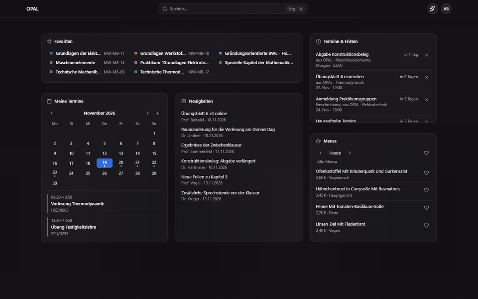
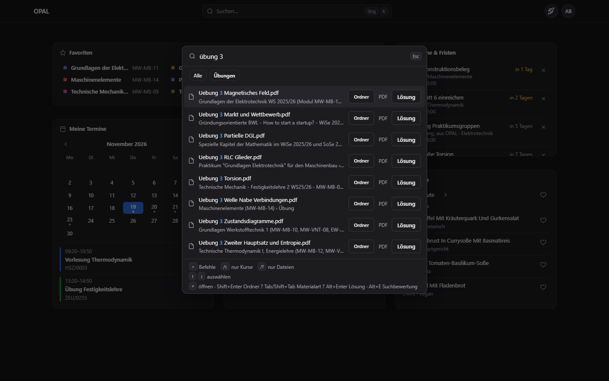
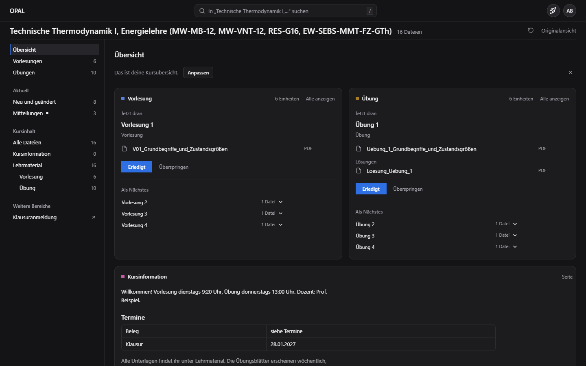

<p align="center"></p>
<h1 align="center">OPAL Redesign</h1>
<p align="center">A calmer home for your courses, materials, and deadlines.</p>
<p align="center">Firefox & Chrome · English & German · <a href="LICENSE">MIT</a></p>



A browser extension that gives OPAL a modern dashboard and a focused course view. Arrange your widgets, find course materials quickly, and keep your university day in one place.

## Features

- **Your dashboard:** rearrange widgets for favorites, news, deadlines, calendar, and Mensa menus.
- **Fast search:** find courses and materials, filter results, and jump straight to files.
- **Focused courses:** browse lectures, exercises, and solutions, track progress, and spot new files.
- **Make it yours:** light and dark themes, custom colors, and English or German interface text.
- **Works with TUfast:** keeps its shortcuts and login integration within reach.

| Search | Course overview |
| --- | --- |
|  |  |

## Install

Get the latest available build from [Releases](https://github.com/Just8it/OpalUIRedesign/releases). For Chrome, extract the Chrome ZIP and choose **Load unpacked** at `chrome://extensions` with Developer mode enabled. Firefox requires a signed add-on for regular installation; unsigned builds can be loaded temporarily at `about:debugging`.

## Development

Use Node.js 22.18+ and npm 10+.

```sh
npm ci
npm run build
npm test
```

`npm run build:chrome` and `npm run build:firefox` create browser ZIPs. See [reviewer build instructions](REVIEWER_BUILD.md) for source packaging and verification.

## Privacy

Settings and search data stay in your browser; there is no custom backend. The extension reads OPAL and fetches Mensa menus from OpenMensa. OPAL page parsing currently targets its German interface.

[Privacy policy](DATENSCHUTZERKLAERUNG.md) · [Terms](ENDNUTZERVEREINBARUNG.md) · [Report an issue](https://github.com/Just8it/OpalUIRedesign/issues)
